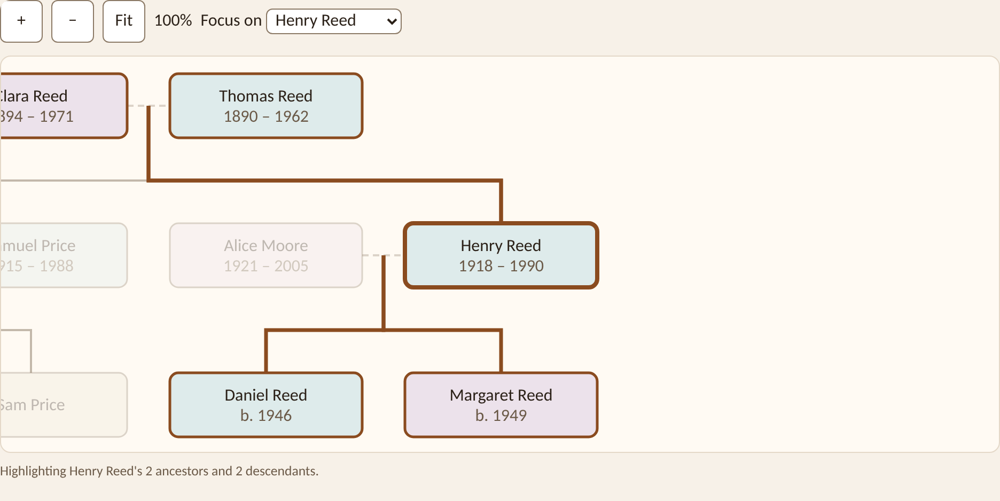

# Cahokia user guide

## Who it's for

Cahokia is for families who want to see their family history at a glance.
It draws a family tree, with parents above their children and partners side
by side, that you can move around, zoom and centre on one person to see
their ancestors and descendants.

Cahokia is early. Today it shows a made-up sample family, three generations
deep, so you can try the tree. You can't add your own family yet. That,
and keeping a signed-in family's tree private, comes next.

## Getting started

1. Open <https://jimhillr-cahokia.pages.dev> in a browser on your computer,
   tablet or phone. Nothing needs installing.
2. Press the menu button (☰) at the top right to open the sidebar, then
   choose **Family Tree**.
3. Press a person's box. Cahokia highlights their parents, grandparents,
   children and grandchildren, and fades everyone else.

The Home, About, History and Explore links at the top tell you about the
ancient city of Cahokia, which the app is named after.

Desktop (Windows, macOS and Linux) and phone apps show the same pages, but
there are no downloads of them yet, so use the web address above.

## How to find your way around the family tree

- **Move around:** drag the tree with your mouse or finger. With a keyboard,
  click the tree first, then use the arrow keys.
- **Zoom:** scroll your mouse wheel or pinch with two fingers, or press the
  **+** and **−** buttons above the tree (or the + and - keys). The number
  beside them shows how far you're zoomed in.
- **See everyone again:** press **Fit** (or the 0 key) to fit the whole
  family in the frame.
- **Each box** shows a person's name and the years they were born and died,
  when those are known. Hover over a shortened name to see it in full.

## How to focus on one person

1. Press their box, or pick their name from the **Focus on** list above the
   tree. Picking from the list also moves the tree so they're in the middle.
   With a keyboard, use Tab to reach a box and press Enter.
2. Their box gets a thick outline. Their ancestors and descendants keep
   their colour, the lines between them get bolder, and everyone else
   fades. The line under the tree says how many ancestors and descendants
   they have.
3. To clear it, choose **No one** in the **Focus on** list or press Escape.

## How to sign in

Press **Sign in with jimhillr** at the top of any page. Cahokia uses your
jimhillr account, the one account that works in every jimhillr app, so if
you already have one (from Cookbook, say) use that. You go to the jimhillr
sign-in page, and after signing in you come back to the page you were on,
with your name and **Sign out** in place of the button. Signing in doesn't change anything yet: it's there for when
your family's own tree is private to the people signed in to it. The
desktop and phone apps can't sign in yet.

## How to change how it looks

Open the sidebar (☰). Its **Appearance** box sets the **Theme**, the
**Colours** (light, dark or match your device) and **Accessible mode**,
which raises the contrast. Cahokia remembers your choice on that device.
In the desktop and phone apps the same box is at the foot of each page.

## Getting help

- **The tree is blank or the page won't load.** Reload the page. Cahokia
  needs a recent version of Chrome, Edge, Firefox or Safari with JavaScript
  turned on.
- **I can't see the whole family.** Press **Fit**.
- **The page scrolls when I try to drag the tree.** Start the drag inside
  the tree's frame, not beside it.
- **Sign-in shows an error, or doesn't bring me back.** Try again from
  the home page. If it keeps happening, report it.
- **I want to add my own family.** You can't yet. It's the next big step.

Cahokia has no feedback button yet. To report a problem, tell the person
who shared Cahokia with you, with the page you were on and what you saw.
