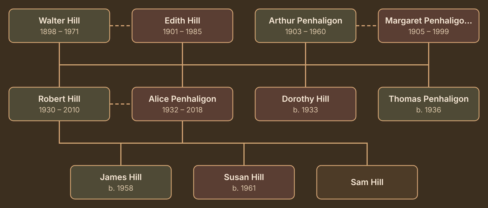

# ui

Dioxus components shared by the cahokia web, desktop and mobile apps.

| Component | What it shows |
| --- | --- |
| `Hero` | The home page banner. |
| `Navbar` | The top navigation bar. |
| `Sidebar` | A slide-out side panel that wraps its children. |
| `FamilyTreeView` | A family tree drawn as inline SVG. |

## FamilyTreeView

Draws a `core::FamilyTree` with the coordinates from
`FamilyTree::tree_layout_with()`: a box per person with their name and birth
and death years, dashed lines between spouses, and lines from each couple or
single parent down to their children, following the routes `core` works out. Names too long for their box are shortened with `…` and shown
in full as a tooltip. An empty tree shows a short message instead.

```rust
use cahokia_core::FamilyTree;
use dioxus::prelude::*;
use ui::FamilyTreeView;

#[component]
fn TreePage(tree: FamilyTree) -> Element {
    rsx! {
        div { style: "overflow: auto;",
            FamilyTreeView { tree }
        }
    }
}
```

The drawing is shown at its natural size, so wrap it in a scrolling container
when the tree may be wider than the screen. Pass `spacing` to change the box
size and gaps (see `core::Spacing`).



The `core` crate is a dependency under the name `cahokia_core`, because a
crate called `core` would shadow Rust's own `core` inside Dioxus macros.
