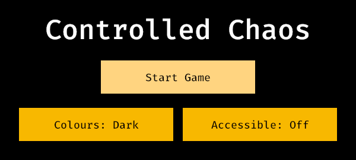
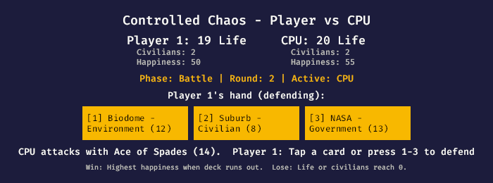

# Controlled Chaos player guide

## Who it's for

Controlled Chaos is a card game for one player against the computer (the
CPU). Each turn one player attacks with a card from their hand and the
other defends with one of theirs; the higher card wins. When the deck runs
out, the happier society wins.

It's for anyone who wants a short game: one game takes a few minutes, and
you can play in a browser, on a Mac or on an Android phone. You don't need
an account, and the game keeps no record of who you are.

The game is an early playtest version. The [official rules](../official_rules.md)
describe the full design, with crisis, profession and society cards that
change the game; today's game plays the simpler version this guide
describes.

## Getting started

Pick where to play:

- **In a browser:** open <https://jimhillr-controlled-chaos.pages.dev>.
  Nothing needs installing. On a computer, click the page once so the game
  hears your keyboard.
- **On a Mac:** download
  [controlled_chaos-macos.zip](https://github.com/jimhillr/monorepo/releases/download/controlled_chaos-nightly/controlled_chaos-macos.zip),
  unzip it and open **Controlled Chaos**. The first time, macOS refuses to
  open it because it isn't notarized: open **System Settings > Privacy &
  Security**, click **Open Anyway**, and confirm.
- **On an Android phone:** open
  [controlled_chaos-android.apk](https://github.com/jimhillr/monorepo/releases/download/controlled_chaos-nightly/controlled_chaos-android.apk)
  on the phone and allow your browser to install unknown apps. Before
  installing a newer build, uninstall the old one.

The browser version updates whenever the game changes, and the Mac and
Android downloads are rebuilt every night.

The game opens on its start screen. Press **Start Game** to begin.

## How to play a game

You are **Player 1**, on the left; the **CPU** is on the right. Each of you
starts with **20 Life**, **2 Civilians** and **50 Happiness**, and three
cards in your hand. Each card shows its name, its category (such as
Technology or Economy) and its value in brackets, from 1 to 14. Only the
value counts in a battle; the category is its colour.

The line under the title shows the phase, the round and whose turn it is,
and the line under your hand always says what to do next. Your turn has
four steps:

1. **Draw.** Tap **Draw card** (or press **Space**) to take a card from the
   deck.
2. **Attack.** Tap a card in your hand (or press its number, **1** to
   **8**) to attack with it.
3. **Battle.** The CPU defends with one of its cards straight away.
   - If your card is higher, the CPU loses 1 Life and you gain 5
     Happiness.
   - If the CPU's card is higher, you lose 1 Life and the CPU gains 5
     Happiness.
   - If they are equal, nothing changes.
4. **End turn.** Tap **End turn** (or press **Space**) to pass to the CPU.

Then the CPU takes its turn: while it acts the game shows "CPU is taking
its turn...". When it attacks, the game shows its card, for example "CPU
attacks with Ace of Spades (14)", and your hand is marked "defending". Tap
a card (or press its number) to defend with it. Both cards in a battle are
used up, whoever wins.

### How the game ends

- **The deck runs out.** The game ends when a player goes to draw and the
  deck is empty. The player with more Happiness wins, so the winner is
  whoever won more battles. Equal Happiness is a draw.
- **A player runs out of Life or Civilians.** They lose straight away.
  (No card takes Civilians yet, and the deck runs out long before anyone
  loses 20 Life, so today every game ends with the deck.)

The result shows where the instructions were, such as "GAME OVER - Player
1 wins! (Happiness: 65 vs 55)". To play again, reload the page in a browser,
or close and reopen the app.

### Tips

- The deck is small: 18 cards, so after the starting hands there are 12 to
  draw. A game lasts about a dozen turns.
- You draw one card a turn but use one to attack on your turn and one to
  defend on the CPU's, so your hand shrinks. If you have no cards when the
  CPU attacks, it wins that battle.
- The CPU always attacks with its highest card, and defends with the
  lowest card that beats yours, or its lowest card when nothing does. So
  save your high cards for defending against its big attacks, and attack
  with a card that is just high enough when you can.

## How to play with keyboard, mouse or touch

Every control works three ways, and you can mix them:

| To | Tap or click | Or press |
| --- | --- | --- |
| Start a game | **Start Game** | |
| Draw a card | **Draw card** | **Space** |
| Attack or defend with a card | the card in your hand | its number, **1** to **8** |
| End your turn | **End turn** | **Space** |

The buttons only appear when they do something, so if you don't see
**Draw card** or **End turn**, it's time to pick a card, or the CPU is
playing.

## How to build a deck

You can't yet. Both players draw from the same shared deck of 18 cards,
shuffled for every game: two copies each of Ace of Spades (14), NASA (13),
Biodome (12) and Stock Market (11), and one each of the cards valued 1 to
10. Choosing your own cards is part of the full design in the
[official rules](../official_rules.md) and will come in a later version.

## How to change how it looks

The start screen has two settings, below **Start Game**:

- **Colours: Dark / Light** switches between the dark colour scheme (the
  default) and a light one.
- **Accessible: Off / On** turns on the strongest contrast, larger text
  and the design system's accessible colours. In a browser it starts
  on if your device asks websites for more contrast.

Press a setting to switch it. The game remembers your choices on your
device, never on a server. To go back to the defaults, clear the site's
data in your browser, or delete the game's `settings.toml` file (on a Mac
it's in `~/Library/Application Support/controlled_chaos/`).

## Getting help

- **The keys do nothing in the browser.** Click the game once so the page
  has the keyboard's attention, then try again.
- **The page stays blank.** Reload it. The game needs a recent Chrome,
  Edge, Firefox or Safari with JavaScript turned on, and it can take a few
  seconds to load the first time.
- **macOS says the app can't be opened.** It isn't notarized yet. Open
  **System Settings > Privacy & Security** and click **Open Anyway**.
- **Android won't install a new build.** Uninstall the old Controlled
  Chaos first, then install the new one.
- **The game says "CPU is taking its turn..." for a long time.** It
  normally moves on in a moment. If it doesn't, reload the page or reopen
  the app; the game doesn't save a game in progress.
- **The game is over and nothing happens.** There is no "play again"
  button yet: reload the page, or close and reopen the app.

In the browser, the game reports when it starts, how far a game gets and
any crash, so problems can be found without you doing anything. These
reports carry nothing that identifies you, and none are sent if your
browser sends Do Not Track or Global Privacy Control. The Mac and Android
apps send nothing.

The game has no feedback button yet. To report a problem or suggest an
idea, tell the person who shared the game with you: say where you played
(browser, Mac or Android), what you did, and what you saw.
