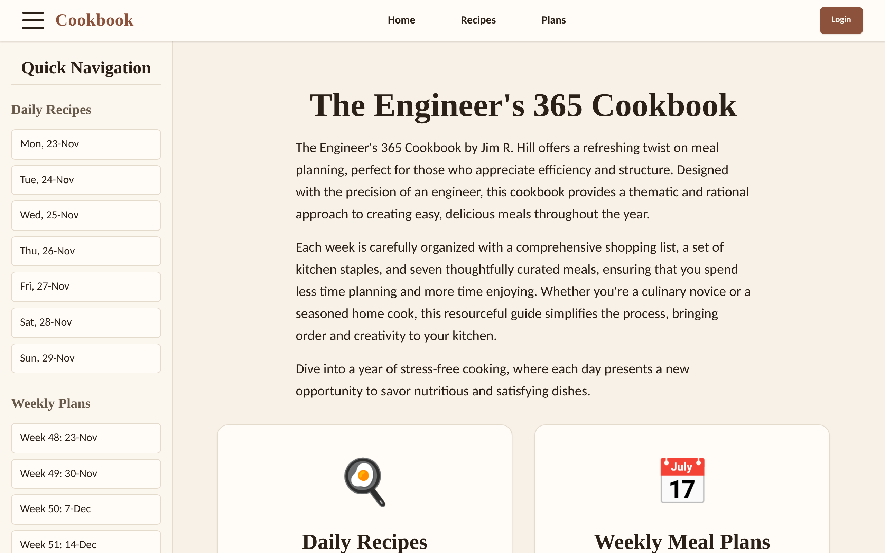
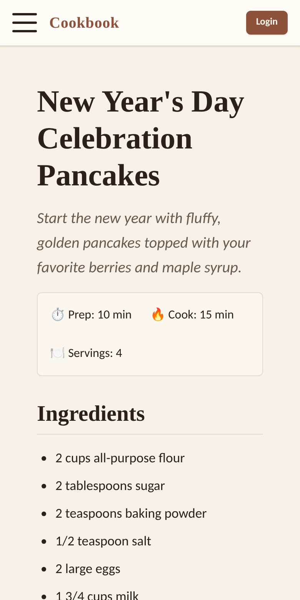
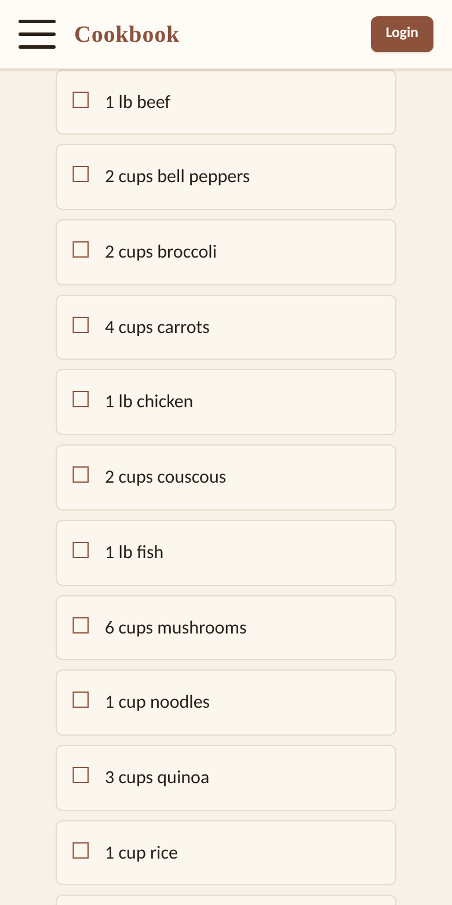

# Cookbook user guide

## Who it's for

The cookbook is for anyone who wants to cook from *The Engineer's 365
Cookbook*: one recipe for every day of the year, and a meal plan for every
week with a shopping list for its seven recipes. It suits people who like to
decide once a week what to cook and shop for it in one trip.

The site is free to read and works on a phone, tablet or computer. You don't
need an account.

## Getting started

1. Open <https://jimhillr-cookbook.pages.dev> in a browser. Nothing needs
   installing.
2. The home page has two buttons. **Browse Recipes** opens today's recipe,
   and **View Meal Plans** opens this week's plan.
3. To come back to a page, bookmark it. Each recipe and plan has its own web
   address, such as `/recipe/32` for recipe 32 or `/plan/48`
   for week 48.

The top of every page has a menu button (☰) that opens and closes the
sidebar, and the **Home**, **Recipes** and **Plans** links. On a computer
the sidebar starts open; on a phone it starts closed. On a phone or a
narrow window, those three links move into the sidebar so the top bar fits
on one row. **Recipes** always opens today's recipe and **Plans** this
week's plan.

The **Login** button at the top right signs you in, but nothing on the site
needs it yet, so you can ignore it.

## How to find a recipe

The cookbook has 365 recipes, numbered 1 to 365. Each week's plan puts
seven of them on the days from Monday to Sunday, and today's recipe is the
one this week's plan puts on today.

- **Today's recipe:** press **Recipes** at the top (or in the sidebar on a
  phone), or **Browse Recipes** on the home page. It's the same recipe as
  today's date in the sidebar and in this week's plan.
- **This week's recipes:** open the sidebar. **Daily Recipes** lists this
  week's plan, one recipe a day from Monday to Sunday, by date.
- **The day before or after:** at the bottom of a recipe, press **← Previous
  day** or **Next day →**. After day 365 it goes round to day 1.
- **A particular day:** change the number at the end of the address, such as
  `https://jimhillr-cookbook.pages.dev/recipe/200`.

There is no search yet, so to find a dish by name, look through a week's
plan or step through the days.

Each recipe shows its prep and cook times and how many it serves, then the
**Ingredients** and numbered **Instructions**, and tags such as the meal and
the cuisine at the end.

## How to follow the week's plan

1. Press **Plans** (or **View Meal Plans** on the home page) to open this
   week's plan. Weeks run Monday to Sunday and are numbered the standard
   way, so a year has 52 or 53 of them.
2. Under **Recipes This Week**, each of the seven recipes is listed with its
   date. Press one to open it.
3. To plan ahead, open the sidebar: **Weekly Plans** lists this week and the
   next three, by the date each one starts. Or change the number at the end
   of the address, such as `/plan/49`.

## How to use the shopping list on a phone

The shopping list is at the top of each week's plan.

1. Open the week's plan on your phone (press ☰, then **Plans**, or a week
   under **Weekly Plans**).
2. **Shopping List** lists every ingredient for the week's seven recipes
   once, with the amounts added up. An ingredient measured two ways has
   both on its line, such as "1 cup + 2 tablespoons butter", and "(and more
   to taste)" means a recipe adds some without a measure.
3. **Staples** lists what you may already have in the kitchen, such as oils,
   salt and pepper, and garlic. Check your cupboard before buying them.

The boxes beside each item are only a guide for your eye: pressing one
doesn't tick it, and the site doesn't remember what you've bought. To keep
the list handy in a shop with a weak signal, keep the page open or take a
screenshot before you go.

## How to change how it looks

Open the sidebar and use **Appearance** at the bottom:

- **Theme** changes the colours and fonts (Earthy is the default).
- **Colours** picks light or dark, or matches your device.
- **Accessible mode** switches to an easier-to-read font and stronger
  contrast, or matches your device's setting.

The site remembers your choice in that browser.

## Getting help

- **The page is blank or stays empty.** Reload it. The cookbook needs a
  recent Chrome, Edge, Firefox or Safari with JavaScript turned on.
- **"Invalid Day" or "Invalid Week".** The number in the address is out of
  range. Days go from 1 to 365 and weeks from 1 to 53. Press **Back to
  Home**.
- **"Page not found".** The address is mistyped. Press **Back to Home**, or
  use the links at the top.
- **I can't see the Home, Recipes and Plans links on my phone.** Press the
  menu button (☰) at the top left; they are at the top of the sidebar.
- **The sidebar covers the page.** Press the menu button (☰) again to close
  it.
- **"Today" shows the wrong day.** The site uses your device's date and time
  zone, so check those are right.
- **A sign-in error shows at the top right.** You can ignore it; every
  recipe and plan works without signing in.

The home page's privacy note explains that visits may be recorded to find
bugs, that what you type is never recorded, and that your browser's Do Not
Track setting turns recording off.

The cookbook has no feedback button yet. To report a problem or a recipe
that doesn't work, tell the person who shared the cookbook with you, with
the page's address and what you saw.
