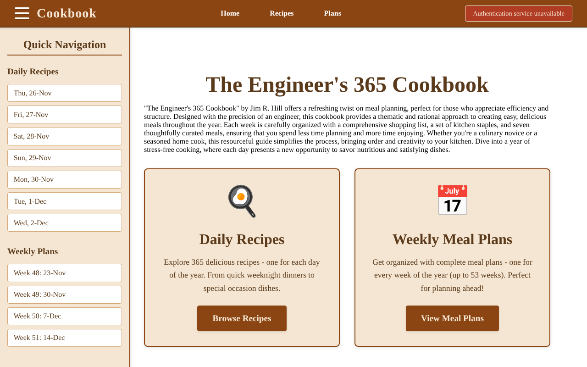
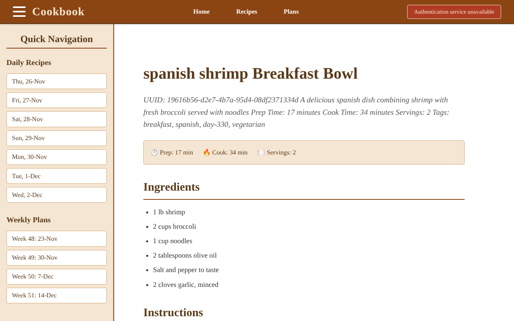
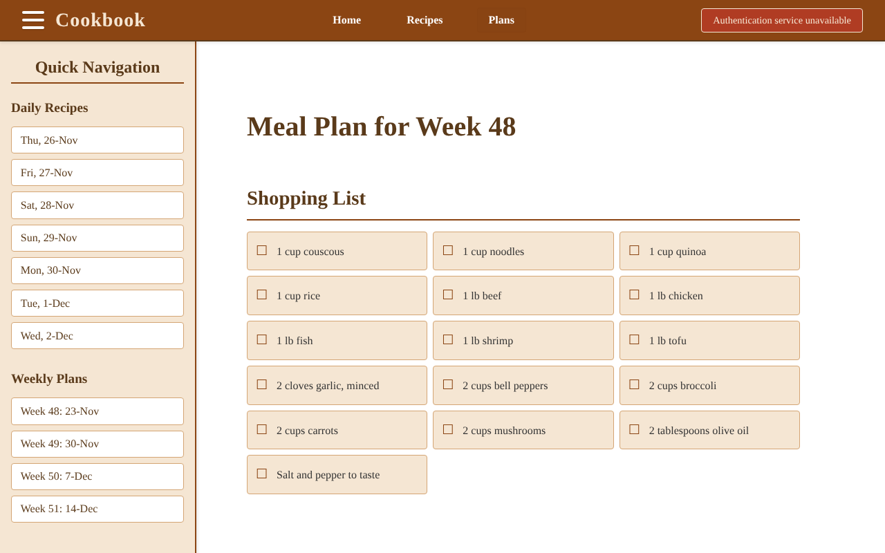
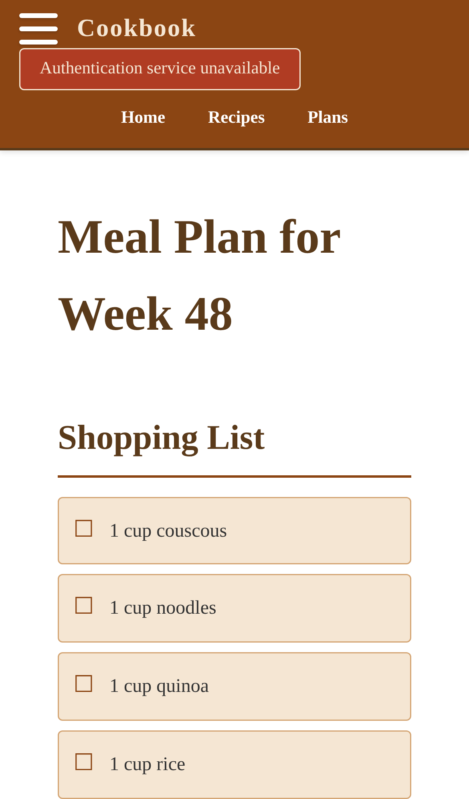
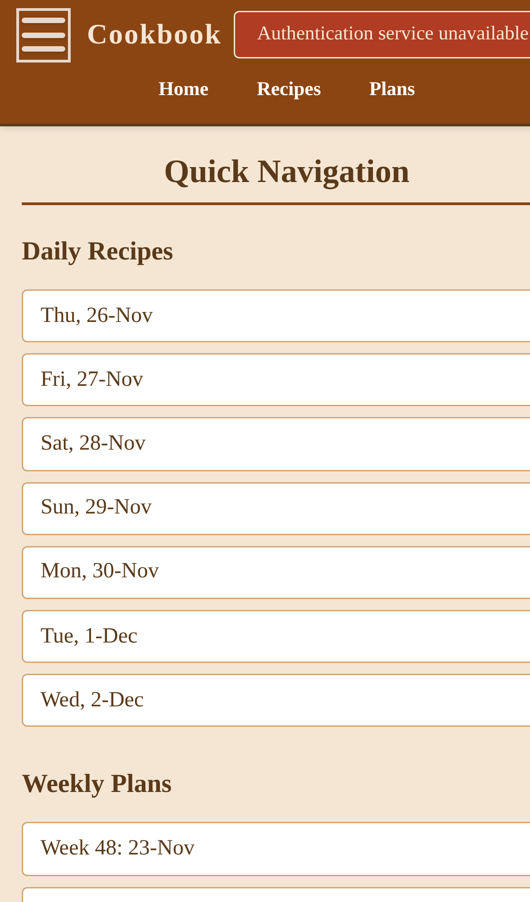

<!-- _class: lead -->

# cookbook
## Deep review, 2026-11-25

Reviewer: Claude (deep-project-review skill, first run)

Why this project: it is the first rotation pick. No project has been reviewed
yet, `cast` is skipped because the Cast to mise migration is removing it, and
`cookbook` is next in the root `ISSUES.md` Priority Projects list.

---

# Executive summary

**What it is:** a Dioxus (Rust to WebAssembly) web app for "The Engineer's 365
Cookbook": one recipe for each day of the year and one meal plan with a
shopping list for each week, deployed to Cloudflare Pages.

**State against its goals:** the *app shell* is mostly there (routing, sidebar,
plans, shopping list, CI, deploy). The *cookbook itself* is not: all 365
recipes are machine-generated placeholders, the shopping list gets
quantities wrong, and the weekly structure the intro promises (themes, kitchen
staples) doesn't exist yet. Sign-in is wired up but does nothing useful.

**Three biggest blockers**
1. No real recipe content, and no way to author it besides hand-editing UUID-named Markdown files.
2. No decision on what sign-in is *for*, so `auth_sdk` stays half-built (`todo!()` in `is_authenticated`, `logout`).
3. Plans are pinned to the 2024 calendar, and week 53 is broken: it will be the *current week* on **2026-12-28**.

---

# Scorecard

| Area | Rating | Why |
| --- | --- | --- |
| Goals | Poor | Shell built; the actual cookbook (real recipes, themes, staples) not started |
| User experience | Fair | Clean, warm design and fast; but metadata leaks into descriptions, raw intro text, wrong shopping quantities, mobile header overflow |
| Architecture | Fair | Sensible core / data / web split; but 1,800-line `main.rs`, half-finished UUID migration, data compiled into the wasm |
| Security | Good | Static site, PKCE + nonce + CSRF in the OIDC flow, CSP present; small gaps (no headers file, code left in URL) |
| Performance | Fair | Loads in under 1 s locally; 3.4 MB wasm (925 KB gzip) with no size tuning |
| Quality | Fair | CI green, 189 Rust + 76 Playwright tests; many tests assert constants, gaps where bugs are |
| Operations | Good | mise CI, Cloudflare Pages deploy, $0 cost, approved vendors only |

---

# Top five recommendations

| # | Recommendation | Impact | Effort |
| --- | --- | --- | --- |
| 1 | Fix week 53 and make plans calendar-independent (plan = recipes for Mon..Sun of an ISO week, not 2024 day numbers) **before 2026-12-28** | High | S |
| 2 | Fix the recipe page: stop metadata lines leaking into the description, render `intro.md` as Markdown | High | S |
| 3 | Make the shopping list add up quantities (and split out "staples" like oil, salt, garlic) | High | M |
| 4 | Decide what sign-in is for; until then hide the Login button | Medium | S |
| 5 | Replace placeholder recipes with real ones, one week at a time, with a simple authoring path | High | L |

---

<!-- _class: lead -->

# Purpose and long-term goals

---

# Who it is for and what it solves

From `cookbook/content/intro.md` (shown on the home page):

> "The Engineer's 365 Cookbook" by Jim R. Hill offers a refreshing twist on
> meal planning ... Each week is carefully organized with a **comprehensive
> shopping list**, a set of **kitchen staples**, and **seven thoughtfully
> curated meals** ... a **thematic and rational approach** ...

- **Audience:** home cooks who want planning done for them, with an engineer's structure.
- **Problem:** deciding what to cook every day and what to buy every week.
- **Product shape:** a free website (Cloudflare Pages, `https://jimhillr-cookbook.pages.dev`).

---

# Long-term goals, and where they are written down

There is no single goals document. These are pieced together from `intro.md`,
`cookbook/ISSUES.md` history, and commit messages. **Goals 5 and 6 are my
inference; please confirm.**

| # | Goal | Source |
| --- | --- | --- |
| 1 | One recipe per day of the year (365) | `intro.md`, ISSUES 2025-12-25 |
| 2 | One plan per ISO week (up to 53) with a shopping list | ISSUES 2025-12-31 (`1bd5a7f`) |
| 3 | Weekly *themes* and *kitchen staples* | `intro.md` only |
| 4 | Rearrange which recipes belong to which plan | ISSUES UUID TODO: "allow future capability to rearrange what recipes belong to plans" |
| 5 | (Inferred) Real, curated recipes by Jim | `intro.md` "by Jim R. Hill"; ISSUES asked for "as much variety as possible" |
| 6 | (Inferred) Signed-in features, such as saved or edited plans | Login added 2025-12-25 "similar to Cahokia"; `RecipeWriter`/`PlanWriter` traits exist |

---

<!-- _class: lead -->

# Progress against goals, and what is holding it up

---

# Progress by goal

| Goal | Status | Evidence |
| --- | --- | --- |
| 1. 365 daily recipes | **Early** | 365 files exist, but generated by `recipe_gen` from templates: 286 unique titles ("Crispy zucchini Bites" appears 15 times), 342 of 365 share the same oil / salt / garlic lines |
| 2. Weekly plans + shopping list | **Partly there** | 53 plan files; plans 1 to 52 work; week 53 fails to parse (2 UUIDs); shopping list drops repeated quantities |
| 3. Themes and staples | **Not started** | No theme or staples field in `Recipe`/`Plan` (`core/src/lib.rs:114`, `:701`) |
| 4. Rearrangeable plans | **Partly there** | UUID migration done (Jan 2026), plans reference UUIDs; but plans still encode 2024 day numbers, no UI to rearrange |
| 5. Real recipes by Jim | **Not started** | All content is generated |
| 6. Signed-in features | **Not started** | Login button only; `is_authenticated`, `logout` are `todo!()` (`auth_sdk/src/web.rs`) |

---

# Activity over time

| Month | Commits touching `cookbook/` |
| --- | --- |
| 2025-12 | 68 |
| 2026-01 | 29 |
| 2026-02 | 4 |
| 2026-03 | 13 (mostly standards and test fixes) |
| 2026-04 to 2026-10 | 0 |
| 2026-11 | 6 (mise migration, review findings, small fixes) |

Most effort since January went into **infrastructure** (UUID migration
tooling, standards audits, Playwright, CI) rather than the product. 120
commits in total; the last product feature (shopping list) landed on
2025-12-31.

---

# What is holding it up (ranked)

1. **Content is the product, and there is no content pipeline.** Recipes are
   UUID-named Markdown files edited by hand; `recipe_gen` only produces
   placeholders. Nothing makes writing 365 real recipes easy, so nobody does.
2. **Undecided scope for sign-in.** Auth0 sign-in adds a network call on every
   page load and a half-built SDK, but enables nothing. Agents keep fixing
   auth bugs (`#414`, `#415`) for a feature with no purpose yet.
3. **The data model fights the goals.** Plans store 2024 day-of-year numbers;
   recipe ids are `day-N`; the web app maps plans back to days by parsing
   `"day-"` from ids (`web/src/main.rs` `get_week_recipes`). Themes, staples and
   rearranging all need model changes first.
4. **Attention.** Seven months with no commits (April to October 2026).
5. **Agent effort skewed to process.** Many recent TODOs are standards,
   tests and tooling, not user-visible progress.

---

<!-- _class: lead -->

# Features

---

# Feature inventory

| Feature | Where | Status |
| --- | --- | --- |
| Home page with intro and two entry cards | `/` | Works; intro shows as one raw paragraph with literal quotes |
| Recipe of the day | `/recipe/:day` (1..365) | Works; description shows metadata (`UUID: ... Prep Time ... Tags ...`) |
| Weekly meal plan | `/plan/:week` (1..53) | Works for 1..52; **week 53 empty** |
| Shopping list per week | on plan page | Works, but merges identical lines instead of adding them |
| Sidebar: this week's recipes, next 4 plans | all pages | Works; days start on the wrong weekday outside 2024 |
| Hamburger toggle, mobile sidebar | header | Works |

---

# Feature inventory (continued)

| Feature | Where | Status |
| --- | --- | --- |
| Invalid day / week and 404 pages | `/recipe/400`, `/anything` | Works; 404 shows a debug `Vec` dump |
| Sign-in (Auth0, PKCE) | header | Partial: redirects to Auth0, but no signed-in state, no logout |
| Leap-year day 366 | `/recipe` | Works (reuses day 365, PR #576) |
| Recipe search, tags, favorites, print | none | Not built |

---

<!-- _class: lead -->

# User experience

---

# How I tested

- Built the release bundle with `dx bundle --platform web --release` (dioxus-cli 0.7.2) and served `dist/public` locally with an SPA fallback.
- Walked the main journeys in Chromium with Playwright at 1280x800 and as an iPhone 12.
- The production URL and Auth0 were **not reachable** from the review sandbox (network policy), so the sign-in error in the screenshots is caused by the sandbox, not the site. The rest is the real build from `main` at `3ca0d3d`.

Journeys: land on home, open today's recipe, open this week's plan, check the
shopping list, try an invalid day, an unknown URL, and the mobile sidebar.

---

# Home



<!-- The intro paragraph is the raw intro.md file in a <p>, so the literal quotes and line wrapping are kept and any Markdown would not render. The warm palette asked for in the Dec 2025 TODO is in place. -->

---

# Home: what works, what hurts

**Works**
- Warm brown and cream palette (the December "warm colours" TODO is done) and a clear two-card choice.
- Sidebar gives one-click access to this week's days and the next four plans.
- First render in about 0.9 s on a local server.

**Hurts**
- The intro is `intro.md` dropped into a `<p>` (`web/src/main.rs` `Home`): literal quotes, no paragraphs, no Markdown.
- "Explore 365 delicious recipes" over-promises given the generated content.
- Header shows "Loading authentication..." then a login button that leads nowhere useful.

---

# Recipe page



---

# Recipe page: findings

- **Metadata leaks into the description.** `data_md/src/parse.rs` `description()` collects every line between the title and `## Ingredients`, which includes `UUID:`, `Prep Time:`, `Cook Time:`, `Servings:` and `Tags:`. Every one of the 365 recipes shows this. A code comment already notes it; it is not in `ISSUES.md`.
- **Content quality:** "spanish shrimp Breakfast Bowl" tagged *vegetarian*, lower-case cuisine words in titles, the same six-line ingredient pattern almost everywhere.
- Tags show `day-330`, an internal id.
- No previous / next day links: the only way on is the sidebar or "Back to Home".

---

# Meal plan page



---

# Meal plan: findings

- **Shopping list quantities are wrong.** `get_week_shopping_list` sorts and
  `dedup`s identical strings (`web/src/main.rs`). Week 48's seven recipes need
  42 ingredient lines; the list shows 16. Olive oil appears 7 times (14 tbsp)
  but is listed once as "2 tablespoons"; shrimp is needed twice (2 lb) but
  listed as "1 lb". A shopper following the list buys too little.
- The `☐` boxes are CSS decoration (`plan.css:58`); they can't be ticked.
- Staples (oil, salt, garlic) are mixed into the list instead of a separate "kitchen staples" block, which the intro promises.
- The recipes for the week sit below the fold, after the shopping list.

---

# Week 53 and the calendar

- ISO 2026 has **53 weeks**. Week 53 runs **2026-12-28 to 2027-01-03**.
- `content/week-53.md` lists 2 recipe UUIDs, so the parser rejects it ("must have exactly 7 recipe UUIDs, found 2", logged on every page load). From **2026-12-07** the sidebar links "Week 53"; from **2026-12-28** the current-week plan, sidebar recipes and shopping list will be **empty**.
- Every plan file is for **2024** ("January 01, 2024 to January 07, 2024", `Days: 330..336` for week 48). In 2026 the sidebar shows Thu 26-Nov to Wed 2-Dec for "this week" instead of Mon 23 to Sun 29: the week starts on the wrong day in every year except 2024.

---

# Mobile

 

<!-- iPhone 12 viewport. Left: the plan page with the header wrapped onto three rows. Right: the sidebar opened from the hamburger button, covering the page. -->

---

# Mobile and accessibility: findings

- Header wraps onto three rows on a phone, and on the sidebar view the auth box is cut off at the right edge.
- Plan title in a very large font takes most of the first screen.
- Sidebar opens as a full-screen overlay with no close button other than the hamburger.
- Accessibility basics are covered by axe tests (`tests/accessibility.spec.ts`) and the hamburger has `aria-label` and `aria-expanded`. No skip link; recipe metadata uses emoji as the only label for prep, cook and servings.
- Error pages: `/recipe/400` explains the valid range (good); the 404 page prints `Attempted to navigate to: ["nope", "x"]`, a debug dump.

---

<!-- _class: lead -->

# Architecture

---

# Components

```text
cookbook/ (Cargo workspace, edition 2024)
├── core/        Recipe, Plan, RecipeReader/Writer, PlanReader/Writer, errors   1,375 lines
├── data_md/     Markdown parsing (parse.rs), file store (lib.rs), embedded store
│                build.rs embeds content/*.md into the binary at compile time   2,290 lines
├── web/         Dioxus 0.7 SPA: router, header, sidebar, pages, auth wiring    1,795 lines (one file)
│                Playwright tests (10 specs, 76 tests, 5 browsers)
├── recipe_gen/  CLI: generates 365 placeholder recipes + one-off UUID migrations 2,810 lines
├── cloudflare/  Pages deploy config (wrangler.toml), no code
└── content/     365 recipe files ({uuid}.md), 53 plans (week-N.md), intro.md
```

External: `auth_sdk` (monorepo crate, OIDC via `openidconnect`), Auth0
tenant, Cloudflare Pages.

---

# Data flow

```text
content/*.md ──build.rs──▶ embedded_recipes.rs / embedded_plans.rs (in OUT_DIR)
                                   │ include! at compile time
                                   ▼
             EmbeddedRecipeStore / EmbeddedPlanStore (OnceLock, parsed on first use)
                                   │
   Route /recipe/:day ──get_by_id("day-N")──┤
   Route /plan/:week ──get_by_week(week)────┴─▶ recipe_uuids ─▶ get_by_uuid (linear scan)
                                                      │
                                     strip "day-" from recipe.id to get the day link
```

- All data ships inside the wasm; there is no backend or API.
- The plan to day mapping goes UUID → recipe → parse `"day-N"` out of the id, so ids still carry the old day-based scheme the UUID migration meant to remove.

---

# Architecture findings

- **One 1,795-line `web/src/main.rs`** holds routing, layout, date logic, data access and 55 tests. Date and plan logic belongs in `core` where it can be tested without the UI.
- **Half-finished UUID migration.** `Recipe.id` (deprecated "day-N") and `Plan.recipe_days` (deprecated) are still read; `get_by_uuid` scans all 365 recipes; `MarkdownRecipeStore` ids don't survive a save and reload (already in `ISSUES.md`).
- **Panics in library code.** `Plan::new` and `EmbeddedRecipeStore::load_embedded_recipes` `assert_eq!`; a bad content file crashes the app at startup (already in `ISSUES.md`).
- **Missing UUIDs get a random one** on every load (already in `ISSUES.md`).
- **Content compiled in** is simple and free to host, but every recipe edit needs a rebuild and redeploy; fine for now, limiting for signed-in editing (goal 6).
- `recipe_gen` carries four one-off migration binaries that have done their job.

---

<!-- _class: lead -->

# Security

---

# Threat model (STRIDE)

Assets: the site's integrity and availability, Auth0 tokens for signed-in
users, Jim's Auth0 tenant. Actors: anonymous visitors, an attacker hosting a
malicious page. Trust boundaries: browser ↔ Cloudflare Pages, browser ↔ Auth0.

| Threat | Exposure | Mitigation in place |
| --- | --- | --- |
| Spoofing (fake login) | Low | Auth0 hosted login, PKCE, nonce, CSRF state checked (`auth_sdk/src/web.rs` `handle_redirect`) |
| Tampering (content) | Low | Static build from `main`; deploy via GitHub Actions with a scoped token |
| Repudiation | n/a | No user actions recorded |
| Information disclosure | Low | Tokens kept in memory only; PKCE verifier and nonce in `sessionStorage` |
| Denial of service | Low | Static CDN; Auth0 outage only breaks the login button |
| Elevation of privilege | Low | No server, no roles, no data writes |

---

# Security findings

| Severity | Finding |
| --- | --- |
| Medium | After sign-in the `?code=&state=` stay in the URL and the stored PKCE / nonce state is never cleared. A reload replays a used code (fails with "Login failed"); the URL with the code ends up in history and could leak via `Referer`. Clear both after the exchange. |
| Low | CSP is only a `<meta>` tag, which can't set `frame-ancestors`, so the site can be framed (clickjacking). There is no `_headers` file for Pages; add one with CSP, `X-Frame-Options`/`frame-ancestors`, `Referrer-Policy`. |
| Low | Login asks for `read write offline_access` scopes it never uses. Ask only for `openid profile email`. |
| Low | `redirect_url` is the current page URL, so every deep link must be an allowed callback in Auth0, or sign-in from it fails. Use one fixed callback route. |
| Low | `cargo audit`: `rsa` 0.9 (RUSTSEC-2023-0071) via `openidconnect`, not exploitable for signature checks; `chrono` flagged unmaintained. Details in the appendix. |
| Info | `npm audit`: 0 vulnerabilities (Playwright test deps). The Auth0 client id in source is fine for a public SPA client. |

---

<!-- _class: lead -->

# Performance

---

# Measurements

| What | Result |
| --- | --- |
| `cargo build` (workspace, cold) | 1 min 23 s |
| `cargo test` (warm) | 13 s, 189 tests |
| `dx bundle --release` | 1 min 31 s |
| wasm size | 3,432,336 bytes (925 KB gzip) |
| JS glue | 88,737 bytes (16 KB gzip) |
| CSS | 6 files, 10 KB total |
| Recipe content embedded | 292 KB of Markdown |
| Home ready (local server, Chromium) | about 0.9 s |
| Network on load | `index.html`, 6 CSS, 1 JS, 1 wasm, plus an Auth0 discovery call |

---

# Performance findings

- **No release size tuning.** The workspace has no `[profile.release]` (only `wasm-dev` and `server-dev`). Adding `opt-level = "z"`, `lto = true`, `codegen-units = 1`, `strip = true` and `wasm-opt` typically cuts Dioxus bundles by a third or more.
- **Auth on the critical path.** `App` starts an OIDC discovery fetch on every page load even for users who never sign in. Load it lazily when Login is clicked.
- **Plans rebuilt on every render.** `Sidebar` calls `get_week_recipes` and `get_sidebar_plan_weeks` on each render, and `get_by_uuid` scans 365 recipes per lookup. Cheap today, but index by UUID once.
- **Week 53 parse warning** is logged on every page load.
- Six separate CSS files, each a request; could be one.

---

<!-- _class: lead -->

# Code quality and testing

---

# CI and tests

- `mise run ci` equivalent run locally on `main` at `3ca0d3d`: `cargo fmt --check` ✅, `cargo clippy -D warnings` ✅, `cargo build` ✅, `cargo test` ✅ (189 passed). CI on PR #585 is green for `cookbook`, `cookbook/web` and `cookbook/cloudflare`.
- Playwright: 76 tests across 10 specs × 5 browser projects (Chromium, Firefox, WebKit, Pixel 5, iPhone 12), including axe accessibility checks.
- **Gaps where the bugs are:** no test checks that a recipe description excludes metadata, that shopping quantities add up, that every plan file parses (week 53), or that a plan's days are Monday to Sunday in the current year.
- **Low-value tests:** several `web` tests assert constants, for example `test_recipe_valid_day_in_range` checks `(1..=365).contains(&1)` without touching app code.
- `cloudflare` is not in the workspace's `default-members`, so `cargo test` at the root skips it.

---

# Against the standards

| Standard | Status |
| --- | --- |
| Lints `unwrap_used`, `expect_used` warn; `unsafe_code` forbid | ✅ set at workspace level |
| No panics in library code (`rust.md`) | ❌ `assert_eq!` in `Plan::new`, embedded store |
| README, CONTRIBUTING, ISSUES per crate | ✅ present |
| README accuracy (`documentation.md`) | ❌ `web/README.md` still says weeks 1-52 and tells you to use Cast |
| E2E for web apps (`testing.md`) | ✅ Playwright |
| Naming | ✅ |

---

<!-- _class: lead -->

# Operations and cost

---

# Build, deploy, observe

- **Build and CI:** mise tasks from `standards/tasks/dioxus-web.toml` and `cloudflare-pages.toml`; PR CI runs only affected projects.
- **Deploy:** pushes to `main` run `mise run deploy` in `cookbook/cloudflare` (`wrangler pages deploy`) to `jimhillr-cookbook.pages.dev`.
- **Observability:** none yet. No analytics, error reporting or uptime check; panics only reach the browser console. The repo-wide plan (root `ISSUES.md`, decision 0001) adds Cloudflare Web Analytics, a telemetry Worker and PostHog replay.
- **Vendors:** Cloudflare (approved), GitHub (approved), Auth0 (approved exception). **Cost: $0** on free tiers.
- **Not verified:** that production currently serves the latest `main`. The review sandbox could not reach `pages.dev`.

---

<!-- _class: lead -->

# Risks and technical debt

---

# Risks

| Risk | Likelihood | Impact | Note |
| --- | --- | --- | --- |
| Empty plan and sidebar during week 53 (from 2026-12-28) | Certain | High | Visible to every visitor for a week |
| Wrong shopping quantities | Certain | High | Breaks the core promise |
| A malformed content file crashes the app | Medium | High | `assert_eq!` on 365 recipes at startup |
| Auth0 tenant changes break login | Low | Low | Feature unused |
| Dioxus 0.7 upgrades | Medium | Medium | `Routable` derive already needed a workaround (`mod route`) |

Debt: one-file UI, deprecated `id` / `recipe_days`, migration binaries,
stale READMEs, `Cast.toml` files.

---

<!-- _class: lead -->

# Recommendations

---

# Prioritized recommendations (1 of 2)

| # | Recommendation | Impact | Effort | Moves |
| --- | --- | --- | --- | --- |
| 1 | Give week 53 seven recipes, and map plans to the Mon..Sun dates of the ISO week in the current year (drop 2024 day numbers). Add a test that every plan file parses. | High | S | Goal 2 |
| 2 | Fix `parse::description` to stop at the metadata block; render `intro.md` with a Markdown renderer. Add tests. | High | S | UX |
| 3 | Shopping list: parse quantity + unit + item, sum by item, and list staples separately. | High | M | Goals 2, 3 |
| 4 | Hide Login until a signed-in feature exists; then clear the code from the URL, drop unused scopes, use one callback route. | Medium | S | Security, perf |
| 5 | Add `_headers` for Pages with CSP, `frame-ancestors 'none'`, `Referrer-Policy`. | Low | S | Security |

---

# Prioritized recommendations (2 of 2)

| # | Recommendation | Impact | Effort | Moves |
| --- | --- | --- | --- | --- |
| 6 | Add a release profile (`opt-level = "z"`, `lto`, `codegen-units = 1`, `strip`) and measure the wasm. | Medium | S | Performance |
| 7 | Move date and plan logic from `web/src/main.rs` into `core`, split the UI into modules. | Medium | M | Architecture |
| 8 | Add `theme` and `staples` to `Plan`, and show them on the plan page. | High | M | Goal 3 |
| 9 | Real content: define the recipe format Jim wants to write in, then replace generated recipes one week at a time. Retire the migration binaries in `recipe_gen`. | High | L | Goals 1, 5 |
| 10 | Mobile header: collapse nav into the sidebar below 768 px; add previous / next day links on recipes. | Medium | S | UX |

Items 1 to 3 and 5 to 7, 10 are filed as `TODO (agent-generated)` in
`cookbook/ISSUES.md` with this PR. Items 4, 8 and 9 wait on Jim's answers.

---

# Questions for Jim

1. **Are the recipes meant to be yours?** Is the goal a real cookbook you write (or curate), and if so, in what format would you like to write recipes: Markdown as today, a spreadsheet, or a small editor in the app?
2. **What should sign-in do?** Saved favorites, your own plans, editing recipes? Or should it go until there is a need?
3. **Weekly themes and staples:** what is a theme (cuisine, season, ingredient)? Should staples be per week or a fixed pantry list?
4. **Calendar:** should week N always be the same seven recipes every year, or should the year matter?
5. **Is the shopping list the main thing users print or use in the store?** That decides how much to invest in quantity parsing and a printable view.

---

<!-- _class: lead -->

# Appendix

---

<!-- _class: small -->

# Method and commands

| Step | Command or source | Result |
| --- | --- | --- |
| Format | `cargo fmt --all --check` | pass |
| Lint | `cargo clippy -- -D warnings` | pass |
| Build | `cargo build` | pass, 1 min 23 s |
| Test | `cargo test` | 189 passed, 0 failed |
| Bundle | `dx bundle --platform web --release --package web` (dx 0.7.2) | pass, 1 min 31 s |
| npm audit | `npm audit` in `cookbook/web` | 0 vulnerabilities |
| cargo audit | `cargo audit` in `cookbook` | 1 vulnerability (low here), 1 unmaintained warning |
| UX | Playwright, Chromium 1280x800 and iPhone 12, local static server | screenshots in this folder |
| History | `git log -- cookbook` (120 commits) | activity table |
| Content | scripts over `content/*.md` | 286 unique titles; week-48 shopping list 42 lines vs 16 shown |

Commit reviewed: `main` at `3ca0d3d`.

---

# cargo audit

`cargo audit` (cargo-audit 0.23.0) in `cookbook/`: **1 vulnerability, 1 warning.**

| ID | Crate | Path | Severity here |
| --- | --- | --- | --- |
| RUSTSEC-2023-0071 (Marvin attack, timing side channel) | `rsa` 0.9.10 | `openidconnect` 4.1 → `auth_sdk` → `web` | **Low**: the attack recovers a *private* key from decryption timing; the app only verifies Auth0's public-key signatures in the browser. No patched `rsa` is reachable until `openidconnect` moves to `rsa` 0.10. |
| RUSTSEC-2026-0543 (unmaintained) | `chrono` 0.4.45 | direct dependency | **Low**: all date logic uses it. Watch for a maintained fork or move to `jiff` / `time` when the date logic moves into `core`. |

Both come from `auth_sdk` or shared crates, so the fix belongs there and
benefits `cahokia` too.

---

# Evidence links

- Recipe description bug: `cookbook/data_md/src/parse.rs`, `fn description`
- Shopping list dedup: `cookbook/web/src/main.rs`, `fn get_week_shopping_list`
- Week 53 plan: `cookbook/content/week-53.md` (`Days: 365, 1`, 2 UUIDs)
- 2024-pinned plans: `cookbook/content/week-48.md` (`Year: 2024`, `Days: 330..336`)
- Auth todo!s: `auth_sdk/src/web.rs`, `is_authenticated`, `is_loading`, `error`, `logout`
- Code left in URL: `auth_sdk/src/web.rs`, `fetch_code_and_state_from_browser`, `handle_redirect`
- Panics: `cookbook/core/src/lib.rs` `Plan::new`; `cookbook/data_md/src/embedded.rs` `load_embedded_recipes`
- Goals history: commits `1bd5a7f`, `ec9c353`; root `ISSUES.md` Priority Projects
