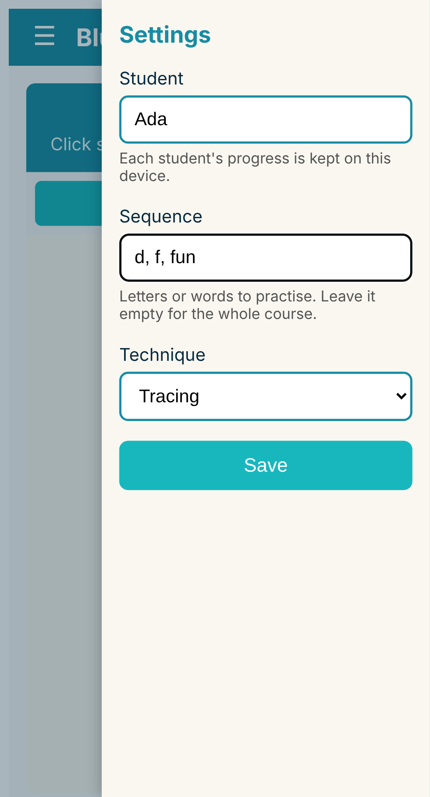

# Using Blue Eel

Blue Eel helps a learner write letters and words by watching each one being
written and then tracing it themselves. It is free, needs no account, and
keeps everything on the device it runs on.

## Who it's for

Learners who are learning to write, often children, including children
with dyslexia or other reading difficulties, and the parents and teachers
who practise with them. Several learners can share one tablet: each one's
progress is kept under their own name.

## Getting started

1. Open <https://jimhillr-sparkhill-webapp.pages.dev> in a browser. Nothing
   needs installing and there is nothing to sign in to.
2. The home page says **Blue Eel**, "Writing made simple!" and has a
   **Begin** button. Press **Begin** to start on the letters, beginning
   with **b**.
3. Optional: press **⋮** at the top right and type the learner's name as
   **Student**, then **Save**, so their progress is kept under their name
   (see [How to set up a learner](#how-to-set-up-a-learner)).

To use it like an app, add it to the home screen: on an iPhone or iPad,
press Share, then **Add to Home Screen**; on Android, open the browser's
menu and choose **Add to Home screen** or **Install app**. It then opens
full screen with the Blue Eel icon.

The page doesn't pinch-zoom on purpose, so a finger on the writing area
always draws.

## How to practise a letter

Each letter (or word) is practised in three steps on the lined writing
area:

1. Press **Start**. Blue Eel shows the letter being written on the guide
   lines. With the Tracing technique (the default) every stroke is drawn
   from its start to its end, in order.
2. When the learner has watched it, press **I'm Ready to Try**. The top of
   the page says "Begin!".
3. The learner traces the letter with a finger, stylus or mouse, in the
   same order and direction they were shown, sitting on the same guide
   lines. Then press **✓**.

Blue Eel checks the tracing:

- **"Great job!"** means it was right. The next letter is shown being
  written; press **I'm Ready to Try** again when ready.
- **"Try again!"** means it wasn't. The learner tries the same letter
  again. After three misses Blue Eel says "Let's try another one." and
  moves on; the missed letter comes back later.

A tracing can sit anywhere across the writing area and can be a little
wobbly. It must have every stroke, start and end in the right places and
sit on the right lines, so a letter drawn backwards, too small, or as a
different letter doesn't pass.

## How to set up a learner

Press **⋮** at the top right to open **Settings**:

- **Student:** the learner's name. Each name has its own progress on this
  device; with no name the progress is kept under "Standard". A new name
  starts afresh.
- **Sequence:** the letters or words to practise, separated by commas, such
  as `d, f, fun`. Single lowercase letters are practised on the letter
  level, capitals on the capital level and longer entries on the word
  level. Leave it empty for the whole course. A sequence's progress is kept
  apart from the whole course's.
- **Technique:** how much help the learner gets.
  - **Tracing** shows every stroke being written.
  - **Pattern** shows only the dots where each stroke starts (green) and
    ends (orange). The dots stay while the learner writes.
  - **Freeform** shows nothing: the learner writes from memory.

Press **Save**. Blue Eel remembers these on this device and starts the open
level again with them. Press outside the panel or Escape to close it
without saving.

A teacher can also share a link that practises only a few letters, such as
`https://jimhillr-sparkhill-webapp.pages.dev/letter?practice=b,d`, or
`/word?practice=hi` or `/capital?practice=T`. A session from such a link
never changes the learner's saved progress. Adding `&tech=Pattern` (or
`Tracing` or `Freeform`) to a link picks the technique.

## How to move through the levels

Blue Eel has three levels: **letters**, then **words**, then **capitals**.
Press **☰** at the top left to jump straight to **Letter Practice**,
**Word Practice** or **Capital Practice**.

- Letters come a few at a time, starting with b, c, d and f. A new group
  opens once the learner has written each open letter right first time
  three times. Misses never end a level.
- When a level is done, Blue Eel says "You are ready for the next level!"
  and shows **Go**. The first time, **Go** starts the same level again with
  Pattern; the next time with Freeform. After Freeform, **Go** opens the
  next level, back with Tracing.
- After the capitals, the congratulations page appears. **Start Over**
  goes back to the home page.

Progress is saved after every letter, so closing the page and coming back
later carries on where that learner left off.

## Getting help

- **Drawing does nothing.** Press **Start**, watch the letter, then press
  **I'm Ready to Try**. The writing area only takes a tracing after that.
- **A letter keeps saying "Try again!".** Start where the demonstration
  starts, follow its stroke order and direction, and keep the letter on
  the same guide lines (tall letters reach the top line, the letter's body
  sits between the dashed line and the base line). Switch **Technique** to
  **Tracing** to see the strokes again.
- **The learner is back at the beginning.** Check the **Student** name in
  **⋮** Settings is spelled the same as before. Progress is kept in this
  browser on this device only, so another device, another browser, a
  private window or clearing the browser's site data starts afresh.
- **The same level started again.** That's expected: each level is done
  with Tracing, then Pattern, then Freeform before the next one opens.
- **Only a few letters come up.** A **Sequence** is set in Settings, or the
  link has `?practice=` in it. Empty the Sequence and Save, or open the
  plain address.
- **The page won't zoom.** That's on purpose, so a finger draws instead of
  zooming.

To ask a question or report a problem, use **Contact Us** on the
[Spark Hill website](website.md#getting-help). Blue Eel itself sends
nothing anywhere, so it has no feedback button.
